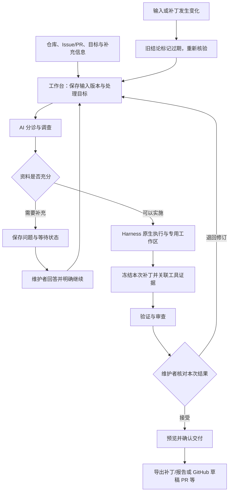

# 开源维护智能工作台

## AI+开源技术报告草稿

| 项目 | 内容 |
|---|---|
| 团队名称 | 待团队确认 |
| 团队编号 | 待团队确认 |
| 作品名称 | 开源维护智能工作台（建议名称，待团队确认；不超过 20 字） |
| 参赛方向 | AI 开发工具与开源协作 |
| 作品形态 | DeepSeek Harness 原生插件与开源维护工作流 |
| 文档日期 | 2026 年 10 月 26 日 |
| 文档状态 | 可继续补充的 Markdown 草稿；不是已提交材料，也不是最终 PDF |

本稿按仓库根目录的[《AIC·AI+开源技术报告参考大纲》](../../AIC·AI+开源技术报告参考大纲.pdf)组织。当前源码参考提交为 `235e79875d35093ae0194443d3343e63b6bddec4`，软件包版本为 `0.4.0`，开发依赖使用 Harness `0.2.1-alpha.1`。编写时工作区存在未提交的源码修改，因此该提交不能单独代表全部当前工作内容，也不是本稿承诺的最终交付版本。

文中的“待团队确认”指身份、权利、开放安排或审核记录尚需团队核实；“待实测”指尚缺与所述结论对应的测量。历史测试用于说明当时的能力与改进，不能自动覆盖当前版本。当前状态及证据入口以[证据索引](EVIDENCE-INDEX.md)和[参赛准备状态](../product/COMPETITION-READINESS.md)为准。本次只更新 Markdown 材料，既有 `output/docx/开源维护智能工作台技术报告.docx` 未随本稿更新，不应视为相同版本。

**作品简介草稿（不超过 300 字）**

开源维护智能工作台面向个人和小团队开源维护者，将 Issue 分诊、代码调查、修复验证、PR 审查和人工交付组织为可追溯的维护流程。作品作为 DeepSeek Harness 原生插件运行，复用宿主的模型、工具、会话与权限能力，补充任务状态、版本约束、同补丁证据关联和中断恢复机制。维护者可以核对结论依据、识别未验证或已过期结果，再决定接受、退回或发布。项目拟提供可复用工作流、评估案例及运行文档；实际开放范围和团队权利待确认，真实维护效果待系统实测。

## 一、作品概述

### 1. 背景与问题

开源维护中的一次问题处理往往跨越多轮讨论、代码修改、测试、审查和版本更新。个人或小团队维护者需要在有限精力下判断：哪些报告值得优先处理，哪些缺少信息，AI 做出的修改是否解决了原问题，以及现有测试究竟对应哪个版本的代码。

通用 AI 对话可以帮助理解和生成代码，但对话中的“已修复”“测试通过”仍需事实支持。尤其在重试、接管、异步回复和 PR 更新后，原先成立的结论可能已不适用于当前产物。维护者若只能在聊天记录、补丁、测试输出和 GitHub 页面之间自行拼接依据，就容易遗漏失败记录或误用旧结论。

本作品聚焦一个具体问题：**如何将 AI 参与的仓库维护转化为有明确来源、能够核对、失效时会提示、发生中断后可以继续的维护结果。** 需求来源于本项目的维护流程设计与安装包试用记录；尚未形成可支持广泛用户结论的访谈或问卷数据，不将个人实践直接代表所有开源维护者。历史实践见[安装包维护试用](../product/INSTALLED-TRIAL.md)。

### 2. 目标、参赛方向与作品形态

作品申报方向为“AI 开发工具与开源协作”。主要服务于需要处理多个 Issue、PR 或仓库维护事项的个人及小团队，目标是帮助维护者完成分诊、组织执行、核对证据和明确交接。

交付形态为 Harness 原生插件。插件内提供收件箱、阶段流程、执行记录、审阅与发布入口；宿主继续提供模型调用、原生工具、会话和执行权限。独立预览用于查看界面与队列及受限的远端资料分析，不能代替原生环境中的代码修改流程。作品不承担自动合并、无人值守发布或多租户执行沙箱职责。

### 3. 核心亮点

- **以维护者的决定组织流程。** 将缺少信息、等待、失败、审阅和交付分别表达，运行完成不自动等于问题解决。
- **让证据对应本次修改。** 关联输入版本、固定提交、补丁和真实工具结果；来源缺失或不匹配时保留未确认状态。
- **让长期维护能够恢复。** 保存处理周期、人工输入、历史尝试和冻结补丁；继续处理时保留旧记录，重新核对适用版本。
- **提供可检查的开放基础。** 仓库包含维护工作流、合成评估案例、实现与运行文档。最终开放范围、有效访问方式及团队授权待确认。

以上是产品设计及实现特征，不代表已证明真实修复率、人工效率或同类产品领先性。

## 二、需求分析与总体方案

### 1. 需求分析

| 维护场景 | 需要解决的问题 | 需求优先级 | 本作品的处理方式 |
|---|---|---|---|
| 多个 Issue 同时进入 | 优先级、重复关系和资料缺口需要人工逐个梳理 | 高 | 批量分诊，保存理由与缺失信息，缺少依据时等待补充 |
| AI 报告生成完成 | 报告状态容易被误认为修复或验证已通过 | 高 | 分开保存执行状态、模型结论和真实工具证据 |
| 多轮修订与 PR 更新 | 上次通过记录可能对应旧输入或旧补丁 | 高 | 按事项、版本、基线与补丁关联证据，变化后提示复核 |
| 执行中断、接管和等待回复 | 难以确认执行到哪一步、已有内容能否继续使用 | 高 | 持久化周期、等待、回答与产物，显式继续并保留历史 |
| 对外发布 | 被接受的报告不一定就是应发布的产物 | 高 | 预览具体内容，再检查批准、版本及目标后交付 |
| 更大规模无人值守运行 | 涉及多身份权限、常驻服务与运行隔离 | 当前非目标 | 保留单 worker、宿主权限及人工确认的适用边界 |

需求分析采用项目实践和案例分析。外部维护者画像、使用频率、判断成本与采纳原因待团队补充试用记录；尚不填写需求覆盖率或满意度。

### 2. 总体方案

系统的主要输入包括仓库固定版本、Issue/PR 与讨论、维护目标、验收条件和维护者补充信息。主要输出包括分诊理由、调查结论、代码或文档补丁、验证与审查结果，以及经确认的发布内容或导出文件。

该图表示主要处理关系，不表示每个事项必须执行全部阶段。缺少信息的事项可以保持等待；调查或审查不要求产生代码修改；接受与发布属于不同决定。

| 层次 | 职责 | 代表性实现入口 |
|---|---|---|
| 原生宿主 | 提供模型、Agent、工具、权限与会话 | DeepSeek Harness；[接入说明](../../README.md) |
| 维护应用 | 仓库接入、目标计划、任务、审阅、交付与人工处理 | `src/application/`、`src/plugin/` |
| 维护规则 | 处理周期、事件、阶段转换及下一步条件 | `src/domain/`、`src/workflow/` |
| 执行与基础设施 | 持久化调度、Git 工作区、快照及 GitHub 访问 | `src/execution/`、`src/infrastructure/` |
| 面向维护者的界面 | 展示当前依据、等待原因、差异与可执行操作 | `src/client/` |

详细模块关系见[架构说明](../product/ARCHITECTURE.md)。

### 3. 可行性与成本

方案复用开源宿主，不训练基础模型。开发和本地流程测试需要 Node.js 24+、Git 及固定软件依赖；模型推理由所选提供方承担，最终服务、模型和部署方式待团队确认。采用已有模型与宿主接口，使项目工作集中在维护规则、证据组织与交接机制上。

执行并发、超时和每次请求输出上限可以配置，但不能据此承诺精确总费用上限。真实 Token、API 支出、人工投入时间与目标设备资源占用待实测。正式试用前应确定允许发送的仓库范围、使用的模型、操作目标和费用边界。当前运行方式依赖进程存活，不作为云端常驻服务或企业级多租户系统交付。

## 三、AI 技术与开源及第三方资源选择

### 1. AI 技术作用

AI 主要承担非结构化资料理解、问题分类、缺失信息识别、代码调查、修改建议与实施、审查发现和文档整理。它适合处理自然语言与源码之间的联系，但可能遗漏上下文、生成错误修改，或把推测写成事实。

工作台不把 AI 的陈述直接作为测试通过或可以发布的依据。模型按阶段提交结构化结论；程序结合当前会话、执行工具记录、固定提交及对应补丁组织证据；维护者再核对实际差异、测试范围与限制。验证和审查使用分离的运行与工作区，但这种分离不等于模型之间完全独立，也不保证结论正确。

### 2. 开源及第三方资源选择

| 资源类别 | 选择及其作用 | 选择依据与限制 |
|---|---|---|
| 原生开发宿主 | DeepSeek Harness `0.2.1-alpha.1` 与共享 Cordis `4.0.5-alpha.1` | 复用插件生命周期、模型目录、工具、会话与权限；兼容性须绑定具体版本验证 |
| 界面与结构化处理 | React、Lucide、Zod、Markdown 渲染组件等 | 复用成熟组件，工作台补充维护语义；具体锁定版本及许可见资源清单 |
| 开源工作流参考 | OpenAI Codex 审查规则及相关公开 Skills | 按固定来源改编，补充中文结构化输出、任务范围与证据要求；保留 Apache-2.0 边界与来源通知 |
| 本地版本管理 | Git 及专用 worktree | 使不同执行拥有独立文件修改空间，支持固定版本与补丁重建；不提供进程、网络或多租户隔离 |
| 外部服务 | 所选模型服务与 GitHub | 提供推理和仓库协作能力；服务条款、数据发送范围、费用与访问权限待最终核实 |
| 评估材料 | 项目内合成案例与测试工具 | 可复现错误状态与流程行为；不能代表真实社区问题的整体分布 |

正式资源清单见[开源及第三方资源清单草稿](RESOURCE-LIST.md)。最终清单应以冻结交付版本的锁定依赖、许可证文件和实际模型配置为准；历史第三方说明不能替代这一核对。

### 3. 自主开发与权利边界

| 边界 | 当前可确认的内容 | 待确认事项 |
|---|---|---|
| 第三方宿主能力 | 模型适配、原生工具、标准 Agent preset、会话、权限与插件框架由 Harness 等上游提供 | 最终分发方式及对应许可义务复核 |
| 第三方改编内容 | 部分维护工作流参考公开 Codex/Skills 文本并进行改编，保留来源与许可记录 | 最终工作流修改与通知是否对应冻结版 |
| 本项目新增实现 | 维护事项与处理周期、阶段编排、版本过期判断、证据关联、冻结补丁交接、审阅和发布约束及相应界面 | 成员分工、具体作者贡献与共同权利边界由团队确认 |
| 通用 AI 辅助 | 仓库记录说明开发、工作流或评估材料存在生成式 AI 辅助 | 实际使用工具/模型、参与环节及团队审核、修改、验证和来源核查记录 |
| 权利声明 | 原创代码的项目许可为 MIT，改编工作流保留 Apache-2.0 边界 | 不据此推定全部内容均为团队原创；共同开发或单位既有成果授权待团队确认 |

正式报告需补充可核验的人工审核与权利确认说明，不能仅凭通过测试认定 AI 生成内容不存在第三方权利问题。

### 4. 融合方式

开源宿主承担执行能力，AI 处理理解与生成，工作台建立维护过程中的规则和证据关系。其组合价值在于：AI 输出可以进入任务流程，但必须结合适用版本和实际执行记录接受检查；发生缺失、失败或变更时，系统保留原因并引导下一步处理。

因此，本项目的主要新增内容是围绕维护协作形成的状态与证据机制。它不是新基础模型；也不将宿主原有的工具能力或开源工作流参考声明为团队自研成果。与基础对话式使用路径的差异，应通过同任务对照与维护者判断实验验证，当前不作未经测量的竞品领先结论。

## 四、设计与实现过程

### 1. 核心功能与流程

1. **接入与分诊。** 读取目标仓库的 Issue/PR、讨论和必要版本信息，输出分类、优先级理由、缺失信息与相关问题建议。信息不足时保持等待，不强行生成修复。
2. **确认目标与组织执行。** 保存维护目标、允许范围和验收条件；代码任务在固定提交的专用工作区运行。维护者可以查看等待原因、原生会话和执行记录，也可以接管。
3. **形成并冻结产物。** 保存本次实际补丁及其来源，后续阶段在新的工作区重建和核验，不仅依赖上一阶段仍可改变的目录。
4. **验证与审查。** 对照本次补丁检查真实工具结果和测试范围，保留失败、未运行与未知状态。通过报告不能覆盖来源不匹配或已过期的证据。
5. **审阅与交付。** 汇总当前结论、差异、同补丁验证及限制。维护者可以退回、接受、导出，或在具体预览后确认 GitHub 回复、标签或草稿 PR 等操作；不自动合并。

### 2. 关键实现

**长期事项与单次执行分离。** 一个 Issue/PR 可以经历多个处理周期，每个周期保存目标、事件、等待和人工回答；一次 Agent 运行单独保存输入、会话和产物。重试不会覆盖旧尝试，旧周期的批准和迟到结果不能推进新周期。

**冻结补丁与同版本证据关联。** 代码阶段保存固定提交到当前内容的完整补丁、补丁指纹和文件树信息。后续阶段重新建立工作区并验证重建结果；审阅时只关联适用的事项、版本、基线和补丁，不能从任意历史记录中挑选一份通过结果。

**显式等待与恢复。** 结构化问题和回答持久化保存。回答、环境就绪或新回复不自动等于授权继续；维护者明确继续后建立新尝试，并保留已有证据。发生输入变化时，原等待与回答的适用性需要重新核对。

**分阶段约束与最终交付核验。** 分诊和预检只处理元数据，不创建代码工作区；调查、审查及实施采用不同阶段规则，执行权限继续受宿主管理。发布前再次核对具体预览、批准和版本，避免审阅后内容变化仍沿用旧批准。

**报告与实际执行分开。** 结构化报告负责表达结论、发现与限制；真实工具结果保留执行命令、退出码及相关产物信息。格式整理用于恢复已有报告，不作为重新实施代码或补造测试证据的途径。

具体实现与适用边界见[架构说明](../product/ARCHITECTURE.md)、[产品定义](../product/PRODUCT-FOCUS.md)及[README](../../README.md)。

### 3. 团队分工与过程记录

当前可由仓库核对的过程包括维护流程实现、安装包试用、受控案例评估、证据组织修正和宿主适配。成员身份与角色、投入时间及各阶段责任尚未在本稿核实。

| 工作角色 | 需要补充的过程材料 | 状态 |
|---|---|---|
| 需求与产品设计 | 需求来源、场景取舍、试用观察与调整理由 | 待团队确认 |
| 插件与维护流程实现 | 主要模块责任、人工修改及版本记录 | 待团队确认 |
| 验证与质量核查 | 测试执行、失败分析、真实试用验收人与结论 | 待团队确认 |
| 许可与材料审核 | 第三方来源核查、AI 辅助审核、共同权利确认 | 待团队确认 |

正式匿名材料可按角色说明分工，不出现学校名称、学校标志或指导教师信息。生成式 AI 辅助说明应写明实际工具、用途、团队如何审核修改，以及遵守模型或平台条款的依据；本稿不代替团队作出这些声明。

## 五、成果展示与效果验证

### 1. 成果展示

当前可检查的成果包括插件源码及构建入口、版本化维护工作流、任务和证据相关界面、评估脚本、合成案例与历史验证材料。仓库提供源码构建、独立预览和原生插件安装说明；评审期间有效的源码、安装包、演示地址及访问权限待团队确认。

正式报告建议只保留能解释价值的少量截图：缺信息事项、同补丁审阅摘要、验证失败、输入变化后过期状态及最终交付预览。截图必须来自最终确认版本，并注明必要的合成或脱敏处理。本稿未新增正式操作截图或录像。演示安排见[设计与演示方案](DESIGN-AND-DEMO.md)。

### 2. 验证方法

验证分为三个层次，分别回答不同问题：

| 层次 | 要回答的问题 | 证据形式 | 不能替代的结论 |
|---|---|---|---|
| 工作流契约 | 交接、版本与错误状态是否按设计处理 | 合成输入、真实本地 Git/测试命令、持久化记录和断言 | 真实模型修复能力与社区适用性 |
| 原生集成与操作 | 插件能否通过宿主工具和界面完成指定路径 | 固定宿主版本、安装包或浏览器记录及执行日志 | 人工效率、模型质量或所有宿主版本兼容 |
| 真实维护试用 | 维护者是否更容易正确判断并接受结果 | 授权仓库、真实模型、逐例产物与独立人工验收 | 未经充分采样的总体成功率或领先结论 |

本稿引用已有历史材料，不把本次文档整理表述为重新执行了这些测试。当前版本的覆盖范围与待补项由[证据索引](EVIDENCE-INDEX.md)集中记录。

### 3. 已有验证结果及限制

2026 年 10 月 2 日的[工作流对照记录](../evidence/evaluation-2026-10-02/SUMMARY.md)保留了固定语料与两个代码版本：基线 `853bc5a75cc2823e407d8a0a6123cabca85d3985`，候选 `d0efd79791288998a642b33d47fd8ad20ab8c999`。八个受控案例中，基线满足五项契约，候选满足八项；该记录反映当时三个流程缺陷的修正，不是模型修复成功率。

| 历史案例 | 已验证的行为 | 限制 |
|---|---|---|
| 缺陷完整流程、无缺陷审查、缺少上下文 | 可重放相应阶段交接与预设结果 | 模型回复由夹具规定 |
| 验证器越界修改后重试 | 不交付违规产物 | 不代表真实模型越界发生率 |
| 未执行却声称测试通过 | 不将模型自报转成已执行通过证据 | 不代表真实模型幻觉率 |
| 二进制交接 | 阶段间新增、修改、删除内容一致 | 仅覆盖记录中的案例 |
| 范围外重复建议与格式恢复 | 拒绝范围外编号，整理报告时不重复实施 | 不代表所有报告异常均已覆盖 |

同日的[安装包试用](../product/INSTALLED-TRIAL.md)在旧版 Harness `0.1.7-alpha.1` 环境中，以合成仓库、脚本模型回复和真实本地工具重放十个操作。记录定位并修正了两处断点：失败验证仍需保留为待处理事项；接受审查后应定位到精确实施产物。前后操作数均为十，不能声称减少了人工点击或提升了速度。该试用也不能直接证明当前 Harness `0.2.1-alpha.1` 版本的完整兼容性。

目前缺少足以支持真实模型成功率、误报率、维护者效率或经济收益结论的系统对照。本稿不据此判断项目是否曾在其他场合使用过真实模型；具体已有真实运行记录需由团队补充并核对其版本、范围与证据。

### 4. 真实维护试用待补记录

真实试用应在授权范围内固定仓库提交、输入和验收条件；若对比基础 Harness 对话与工作台，应尽量保持模型、推理配置、任务范围和环境一致，记录分配顺序及差异。最终验收由团队指定人员依据产物判断，不由同一模型自行给最终分。

| 样本类别 | 仓库/事项与固定版本 | 提供方、模型及配置 | 核验内容 | 人工结论、失败原因及证据 |
|---|---|---|---|---|
| 具体缺陷 | 待团队确认 | 待团队确认 | 修复前复现、本次修改、修复后结果、无关改动 | 待实测 |
| 信息不足事项 | 待团队确认 | 待团队确认 | 是否提出必要问题、是否避免无依据实施 | 待实测 |
| 无缺陷或无需修改的 PR | 待团队确认 | 待团队确认 | 是否产生误报及其影响 | 待实测 |
| 多轮修订/版本变化 | 待团队确认 | 待团队确认 | 旧结论是否失效、重新核验是否明确 | 待实测 |
| 等待与接管恢复 | 待团队确认 | 待团队确认 | 历史与已有产物是否可核对、是否需要重复解释目标 | 待实测 |

| 效果指标 | 记录口径 | 当前状态 |
|---|---|---|
| 可接受结果 | 经人工验收的数量及总样本数，保留不接受原因 | 待实测 |
| 误报与无关修改 | 在对应样本中逐项记录，不只统计成功案例 | 待实测 |
| 判断与审阅成本 | 维护者完成判断所用时间、补查资料与返工记录 | 待实测 |
| 运行投入 | 实际 Token、费用、墙钟耗时及异常重试 | 待实测 |
| 复用可行性 | 其他维护者按公开说明接入并完成一次指定任务 | 待实测 |

小规模试用应报告样本数与具体结果，不外推为所有开源仓库的表现。未取得可核验记录前，以上指标保持待实测，不填估算的收益百分比。

## 六、创新性与开放价值

### 1. 创新性

作品的创新重点是维护协作中的判断依据与过程约束，当前不主张新的基础模型算法或未经检索证明的“首创”。

| 常见维护难点 | 本项目的实质设计 | 应提供的验证 |
|---|---|---|
| AI 结论容易替代事实 | 报告、工具输出与验证状态分开，按来源组织 | 未执行却自报通过的可重放错误案例 |
| 旧结论被用于新代码 | 同事项、同版本、同补丁关联，变化后重新核验 | 更换输入或补丁后旧审核失效的记录 |
| 多轮任务依赖个人记忆 | 事项、周期、运行和人工输入分别持久化 | 中断/接管后的可核对恢复过程 |
| 接受报告后交付对象不清 | 审查回到精确实施产物，接受与发布分离 | 审阅、预览及交付指向同一产物的记录 |

这些设计使开源宿主、AI 执行与人工维护形成可检查的处理链。实际价值仍需由真实试用证明，不能用模块数量、代码规模或模型数量替代。

### 2. 开放成果

拟提供的复用对象包括插件、维护工作流、受控错误案例、运行教程和证据说明。项目现有原创代码许可为 MIT，改编工作流保留 Apache-2.0；第三方组件、外部模型服务和仓库原始内容各自适用其许可或服务条件，不因使用本插件而变更权利。

上述内容是否已对外开放、最终公开地址、分发包范围和团队是否具备完整再分发权，均待团队确认。含凭据、私人仓库内容、个人信息或受限材料的记录不得直接混入开放成果。

### 3. 社区贡献与复用

本稿不声称已获社区采纳、产生用户规模或完成上游合并。若有 Issue、PR、补丁或文档贡献，应补充原始链接、状态和对应贡献内容；暂无记录时如实说明。

即使暂未形成上游贡献，其他维护者仍可通过安装插件、复用工作流、重放错误案例和检查证据格式理解本方案。建议以一次外部维护者独立接入记录证明文档与安装方式可复用，不以仓库浏览量或未经核实的下载数据代替。

### 4. 维护计划

后续优先完成冻结版本验收、真实维护试用和材料一致性检查，再根据实际失败原因改进。反馈入口、维护责任人、支持版本范围及更新周期待团队确认。是否将证据格式和错误案例整理成可独立复用的说明，由团队结合时间与用户反馈决定，不在本稿承诺已完成。

## 七、合规、安全与风险说明

### 1. 开源及第三方许可合规

仓库保留项目 LICENSE、第三方说明和许可证文件；工作流改编的 Apache-2.0 边界与原创代码 MIT 分开记录。最终交付需逐项核对固定版本、来源、署名、LICENSE/NOTICE、再分发条件及分发包内文件，不能只凭依赖名称判断合规。模型、平台与 API 适用条款待最终服务选定后核实。资源公开可访问，不自动表示获得复制、训练、改编或再分发授权。

### 2. 数据、权利与隐私

插件读取的仓库源码、Issue/PR、讨论和工具日志可能含个人信息、保密内容或受许可约束的材料。使用前应确认有权读取、向所选模型发送和保存的范围；真实试用材料须核对脱敏及展示授权。当前合成评估不等于取得任意公开或私人仓库的再分发许可。

原生模型凭据由宿主管理；插件自身连接凭据保存在服务端配置中，任务导出不应包含秘密。正式交付仍需检查截图、日志、安装包和报告附件中的令牌、认证链接、绝对私人路径及个人信息。真实示范仓库、数据发送目的地和保留期限待团队确认。

### 3. AI 输出、知识产权与内容安全

主要风险包括模型幻觉、不完整审查、错误补丁、把仓库内容误当指令、超范围修改和生成内容来源不明。工作台以阶段范围、宿主权限、固定输入、实际差异、工具证据、人工审核和发布预览降低风险，但不能保证完全识别提示注入或所有有害输出。

AI 生成代码或文本需要人工审阅、必要修改、测试和来源核查；测试通过不能替代知识产权核查。团队实际审核了哪些材料、如何处理疑似引用和使用了哪些模型/平台，应在正式提交前补充。当前不声明所有生成内容均已完成权利核验。

### 4. 知识产权与公开边界

项目新增实现、第三方改编、通用 AI 辅助内容及其他共同权利部分应分别说明。团队成员、共同开发方、学校/实验室既有成果授权、专利或保密安排待团队确认。本稿不替代授权书或权利声明，也不据现有仓库许可推定团队有权公开全部内容。需受限提交的部分，应说明范围、评审访问办法与后续开放安排。

### 5. 其他风险与适用边界

- 专用 worktree 隔离文件修改，命令、网络和进程权限仍由宿主承担；不适用于把不可信任务作为多租户服务直接运行。
- 仓库资料与 PR 差异存在读取上限及可能截断，检查范围必须展示；局部通过不能表示整个仓库无缺陷。
- 单 worker、轮询和进程存活条件限制了并发与持续运行；中断恢复不等于所有外部操作具备通用的恰好一次执行保证。
- 模型结果、远端 CI 和维护目标都可能变化，人工审核与版本核验仍是必要条件。
- 当前效果结论和兼容范围受已记录版本与样本限制，不适宜承诺无人监督维护、安全关键系统正确性或企业级可用性。

## 八、总结与展望

### 1. 项目总结

开源维护智能工作台把 AI 理解与执行接入开源维护流程，在宿主已有能力之上补充了长期事项状态、版本约束、同补丁证据和可恢复交接。历史受控评估表明相关流程缺陷能够被定位和回归验证；安装包试用也提供了真实本地工具参与的处理记录。

作品目前仍需完成与最终版本对应的验收、系统真实模型对照、外部维护者试用、开放访问和权利材料确认。现阶段主要可核验价值是维护过程的可检查性，尚不能给出真实修复率、人工节省时间或经济收益结论。团队个人收获与职责总结待团队确认后补入。

### 2. 后续计划

1. 冻结交付代码、依赖与安装包，补齐当前 Harness 版本的安装、操作及关键恢复场景验收。
2. 在明确授权和成本边界内完成代表性真实维护任务，保存失败样本，并由人工独立验收。
3. 请其他维护者按文档完成一次接入，记录障碍与判断依据是否充分，再修正文档和流程。
4. 核对许可、AI 辅助审核、共同权利和开放范围，建立有效反馈入口。
5. 按实测证据完成匿名技术报告与演示视频，统一其中的代码版本、截图、指标与访问方式。

## 九、附录

### 1. 资源、来源与运行入口

| 材料 | 用途 |
|---|---|
| [开源及第三方资源清单草稿](RESOURCE-LIST.md) | 按冻结依赖、实际模型/服务与许可核对最终使用清单 |
| [项目 LICENSE](../../LICENSE)、[第三方说明](../../THIRD_PARTY_NOTICES.md) | 区分项目许可、第三方许可和历史资源记录 |
| [README](../../README.md) | 启动、安装、原生模式和独立预览的使用边界 |
| [证据索引](EVIDENCE-INDEX.md) | 对照版本、证据类型、已测与未测内容 |
| [设计与演示方案](DESIGN-AND-DEMO.md) | 将价值主张与具体演示证据对应 |
| [参赛准备状态](../product/COMPETITION-READINESS.md) | 核查最终材料、资格与授权的待办 |
| [架构说明](../product/ARCHITECTURE.md)、[产品定义](../product/PRODUCT-FOCUS.md) | 理解方案边界、状态、证据和恢复机制 |
| [可复现评估](../EVALUATION.md)、[历史评估摘要](../evidence/evaluation-2026-10-02/SUMMARY.md) | 重放受控工作流案例，核对历史结果与测量限制 |
| [安装包维护试用](../product/INSTALLED-TRIAL.md) | 核对旧版环境的试用过程与合成条件 |
| [官方技术报告参考大纲](../../AIC·AI+开源技术报告参考大纲.pdf) | 核对报告结构；最终提交规范另以官方最新要求为准 |

代码仓库、评审安装包、演示视频或网盘的最终有效链接及访问条件：**待团队确认**。上游贡献链接及状态、真实用户反馈、受限提交说明和开放时间：**待团队确认**，不得以本稿中的仓库目录链接代替已经对外可访问的评审入口。

### 2. 正式交付前必须替换或补齐的内容

- [ ] 确认作品名称、团队名称、团队编号、参赛方向与报告日期，并保持匿名要求。
- [ ] 指定最终代码提交、未提交修改处置、安装包版本及校验信息，使报告、截图、视频与包一致。
- [ ] 补齐当前宿主版本的验收记录，区分历史夹具、当前集成、真人操作和真实模型试用。
- [ ] 填写真实试用样本、模型配置、人工验收、失败原因与实际 Token/费用；无测量的指标继续留空或删去，不补估算收益。
- [ ] 补充实际成员分工、AI 辅助环节、团队审核修改验证记录和来源/权利核查依据。
- [ ] 完成最终模型、平台/API、数据和依赖许可清单，核对分发文件及共同权利授权。
- [ ] 确认已公开与拟公开范围、评审期间有效访问链接、权限和受限提交安排。
- [ ] 替换正式截图与演示视频，标明合成或脱敏场景，不把错误注入案例说成真实模型效果。
- [ ] 如存在上游贡献或社区反馈，补原始链接及实际状态；没有则如实表述。
- [ ] 删除或妥善改写正文中的待确认标记，复核所有效果主张均有对应证据。
- [ ] 按官方要求排版并导出最终 PDF，核对文件大小、正文篇幅与匿名性。本稿本身尚未生成或提交该 PDF。

本清单用于把草稿转成可核验的正式材料，不代表报名、缴费、授权、材料上传或参赛提交已经完成。
